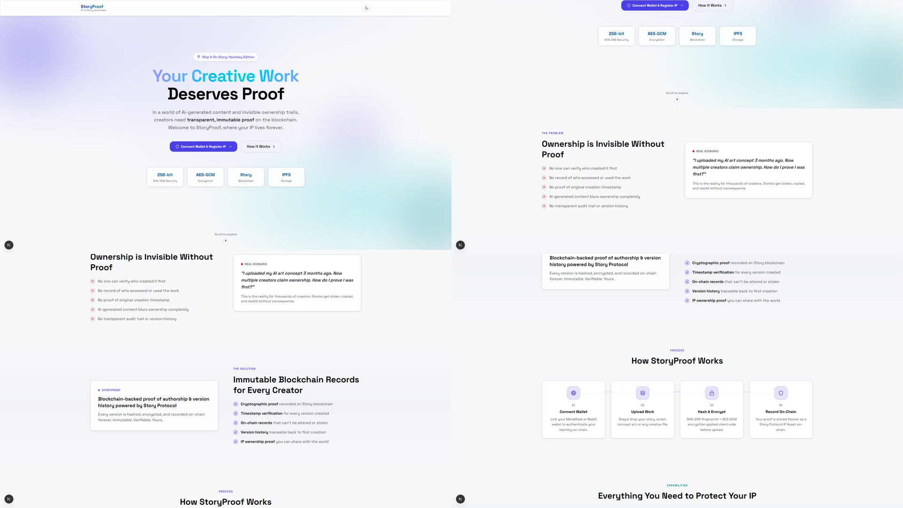

<div align="center">

# 📜 StoryProof — Blockchain IP Fingerprinting & Ownership Proof
### Client-side SHA-256 hashing, AES-GCM encryption, and Story Protocol IP Asset minting

<!-- BADGE ROW 1 — Context & Status -->
[](#)
[](#)
[](#)
[](#)

<!-- BADGE ROW 2 — Actual Tech Stack -->


> **Context line:** Ship It On Story: Hackday (Nagpur, India) &nbsp;|&nbsp; **Category:** Decentralized IP Protection & Cryptographic Proof &nbsp;|&nbsp; **Target Network:** Story Odyssey Testnet (Chain ID 1513)

🔴 **Demo:** Coming soon — will be replaced with 🔗 **[Live Demo](https://storyproof.vercel.app)** once hosted

</div>

---

## 📸 Preview



## 🧠 Overview

StoryProof is a decentralized intellectual property (IP) protection dApp designed to prove creative file ownership on-chain. Every uploaded file generates a client-side SHA-256 fingerprint, an AES-GCM encrypted payload, an IPFS content identifier (CID), and registers a verifiable IP Asset on Story Protocol's Odyssey Testnet with immutable timestamping.

## ✨ Key Features

- **Client-Side SHA-256 & AES-GCM Encryption** — Computes cryptographic fingerprints and encrypts files locally before payload transmission using Web Crypto API.
- **Story Protocol On-Chain IP Asset Minting** — Integrates `@story-protocol/core-sdk` to register IP Assets and submit immutable version checkpoints to smart contracts.
- **Decentralized Pinata IPFS Storage** — Real IPFS storage pinning with fallback to mock CIDs when running in offline offline mode.
- **Branded Ownership Certificate Export** — Generates downloadable A4 PDF ownership certificates complete with file hashes, CIDs, and wallet signatures via jsPDF.

## 🏗️ Architecture

```
[ User File Selection ] ──▶ [ Web Crypto API (SHA-256 + AES-GCM) ]
                                          │
                        ┌─────────────────┴─────────────────┐
                        ▼                                   ▼
             [ Pinata IPFS Storage ]           [ Story Protocol SDK ]
                        │                                   │
                        └─────────────────┬─────────────────┘
                                          ▼
                      [ Odyssey Testnet / Local Audit Trail ]
```

The application uses a zero-trust client architecture. Cryptographic hashing and symmetric encryption execute entirely in browser memory before file chunks reach external IPFS storage nodes or smart contract registers.

## 🔥 The Hard Part

**Problem:** Minting on-chain IP Assets required active Web3 wallet connectivity, gas tokens, and live Pinata IPFS JWT authentication, which caused app breakage during offline testing or wallet-less user exploration.  
**Approach:** Built strict hardware provider dependencies that threw unhandled exceptions when MetaMask was missing or locked.  
**Solution:** Developed a dual-mode fallback state machine (`lib/storage.ts`). Client-side SHA-256 hashing and AES-GCM encryption execute deterministically in all environments, while IPFS uploads and smart contract checkpoints seamlessly degrade to `localStorage` audit trails when Web3 environment variables are unset.

## 📁 Project Structure

```
IP-Leak-Defense-System-StoryShip/
├── app/
│   ├── globals.css           # Tailwind v4 glassmorphic design system
│   ├── layout.tsx            # Root layout with fonts & toast providers
│   └── page.tsx              # Landing page & core application router
├── components/
│   ├── dashboard.tsx         # Tabbed dashboard (Upload, Verify, Network, Files)
│   ├── file-upload.tsx       # Drag-and-drop upload with progress indicators
│   ├── file-verifier.tsx     # SHA-256 hash recalculation & comparison tool
│   └── wallet-connect.tsx    # MetaMask wallet connection component
├── lib/
│   ├── blockchain.ts         # Smart contract interaction handlers
│   ├── storage.ts            # File processing, encryption, & Pinata IPFS
│   └── story-protocol.ts     # Story Protocol SDK IP Asset helpers
└── README.md
```

## 🚀 Run It Locally

```bash
# 1. Clone repository
git clone https://github.com/msuryawanshi05/IP-Leak-Defense-System-StoryShip.git
cd IP-Leak-Defense-System-StoryShip

# 2. Install dependencies
pnpm install

# 3. Start local development server
pnpm dev
```

Open [http://localhost:3000](http://localhost:3000) in your browser.

### Config / Environment Variables

The application runs **fully offline** without environment variables. To enable real Pinata IPFS pinning and Story Protocol Odyssey Testnet smart contract transactions, copy `.env.local.example` to `.env.local`:

```env
NEXT_PUBLIC_STORY_TESTNET_RPC_URL=https://odyssey.storyrpc.io
NEXT_PUBLIC_USE_STORY_TESTNET=true
NEXT_PUBLIC_PINATA_JWT=your_pinata_jwt_here
NEXT_PUBLIC_PINATA_GATEWAY=https://gateway.pinata.cloud
```

## 📎 Docs & Resources

- 🌐 [Story Protocol Odyssey Explorer](https://odyssey-testnet-explorer.storyrpc.io) — Chain ID 1513 explorer
- 📦 [Pinata Cloud Documentation](https://docs.pinata.cloud) — Decentralized IPFS pinning documentation

## 📈 What's Next

- [ ] Programmable IP Licenses (PILs) with automated royalty revenue splitting
- [ ] AI-driven audio/image similarity and plagiarism detection engine
- [ ] Multi-party co-creator permissioned signing

---

<div align="center">

Built by **msuryawanshi.05**

</div>
